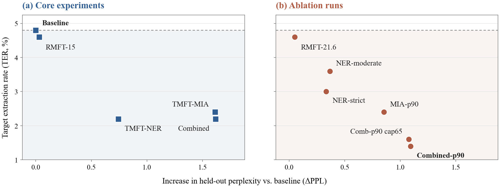
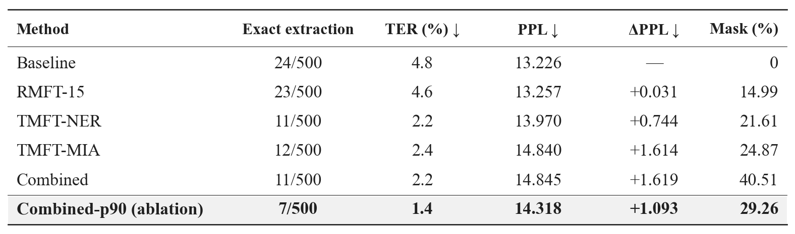
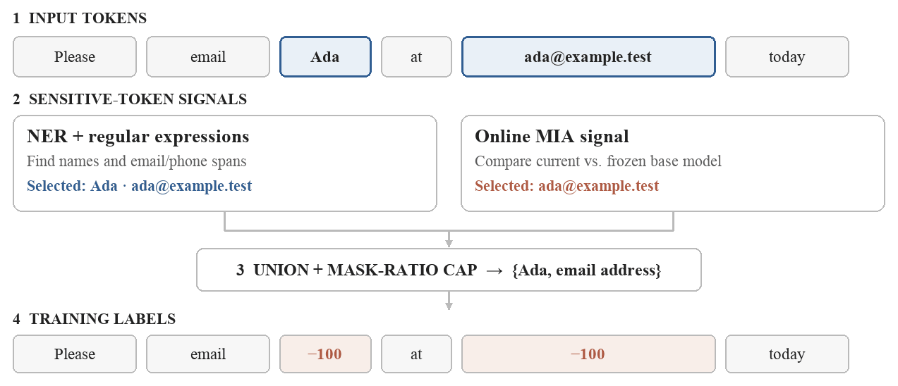

# TMFT: Targeted Masked Fine-Tuning

**Can a language model learn from emails while memorizing fewer private strings?** TMFT studies a simple intervention during LoRA fine-tuning: omit selected privacy-sensitive tokens from the training loss. We compare targeted masking with ordinary fine-tuning and random loss masking on a Pythia-160M model trained with Enron emails.

## Results at a glance

In the reported 500 exact-extraction attacks, the baseline exposed 24 targets (TER **4.8%**). The core TMFT-NER condition exposed 11 (**2.2%**, a **54.2% relative reduction**) with a **+0.744** increase in held-out perplexity. The lowest TER in the reported ablations was **Combined-p90: 7/500 (1.4%)**, a **70.8% relative reduction**, with **+1.093** perplexity. These are different experimental conditions, not interchangeable headline results.



**Figure 2: Privacy–utility operating points.** Each point is one run reported in the summary slides. The panels use the same scales and separate core experiments from ablations by color and marker. The dashed line marks the baseline TER (4.8%); the lightly shaded area falls below it. Lower TER and smaller ΔPPL are preferable. Error bars were not reported.



**Table 1: Privacy and utility across masking strategies.** The table shows the five core conditions and the lowest-TER ablation, Combined-p90 (shaded). Values match the reported summary results. TER is target extraction rate. ΔPPL is measured against the unrounded baseline PPL of 13.2256. These are reported observations without confidence intervals.

At the same reported **21.61%** masking budget, TMFT-NER had **2.2% TER** versus **4.6%** for RMFT-21.6. Its utility cost was also higher (**+0.744** versus **+0.050** ΔPPL), so targeted masking did not dominate random masking on every metric. The [full 11-condition data](docs/data/summary_metrics.csv) also include seen-target extraction rate, two membership inference AUCs, and skip counts. See the [data notes](docs/data/README.md) for definitions and provenance.

## Method



**Figure 1: Targeted loss masking pipeline.** This animated example uses synthetic text. NER/regex and online MIA select token positions; their union is excluded from the training loss by setting the corresponding labels to `-100`. The input tokens remain visible to the model. [View the still image](docs/figures/method_overview_animatic_v4.png).

1. **NER masking:** spaCy entity recognition and email/phone regexes identify sensitive character spans, which are mapped to tokenizer positions.
2. **MIA-guided masking:** after a warm-up of 50 batches, compare token scores from the current model with a frozen base model and mask the highest-risk fraction selected by the threshold.
3. **Combined masking:** use the union of the NER and MIA masks. Set selected training labels to `-100`, so they contribute no cross-entropy loss. Skip a sample occurrence when the mask-ratio cap would be exceeded.

The core CLI conditions are `baseline`, `rmft` (random 15% masking), `tmft_ner`, `tmft_mia`, and `tmft_combined`. The additional p90 and mask-budget variants are analysis runs reported in the summary data, not separate `--method` choices in the current CLI.

## Evaluation and scope

The reported setup uses **Pythia-160M + LoRA** and the **Enron Email** dataset. Exact extraction tests give the model a 50-token prefix and check 50 greedy-generated tokens against a normalized PII target. TER is the success rate over 500 attacks; SER uses 454 targets seen in training. Utility is held-out perplexity, and membership inference is summarized by Loss-MIA and Min-K AUC.

The numbers above come from the project's summary slides and were transcribed into a [versioned CSV](docs/data/summary_metrics.csv); this repository does not include the original checkpoints or raw evaluation outputs for those exact runs. They reflect one model and dataset setup, without confidence intervals. The study evaluates an empirical mitigation: it does **not** provide differential privacy guarantees or machine unlearning.

## Run the experiment

Install the pinned dependencies from the repository root, then download the spaCy model:

```bash
python -m pip install -r requirements.txt
python -m spacy download en_core_web_sm
```

The tested stack uses PyTorch 2.3.1, Transformers 4.41.2, PEFT 0.11.1, and Datasets 2.20.0. In a Jupyter environment, restart the kernel after installation.

```bash
python main.py --mode prepare --force_prepare  # prepare real Enron splits and PII targets
python main.py --mode train --method all        # train the five core conditions
python main.py --mode eval --method all         # evaluate privacy and utility
python main.py --mode plot                      # plot the current run's results
```

Or run the full pipeline with `python main.py --mode all --method all --force_prepare`. The interactive entry point is [`tmft_experiment.ipynb`](tmft_experiment.ipynb). The default [configuration](configs/config.yaml) disables synthetic fallback, so dataset access failures should stop preparation rather than silently replace real data.

Run outputs are written under `data/processed/`, `data/pii_eval.json`, and `results/` (adapters, tables, figures). These generated paths are ignored by Git; inspect them before sharing because the evaluation targets and model artifacts may expose private strings.

To regenerate the **README figures from the reported CSV**, run:

```bash
python scripts/render_readme_figures.py
```

This command redraws the README figures and animation. It does not train the model or recompute the reported metrics. The experiment's `--mode plot` command instead plots results from a fresh local run.
